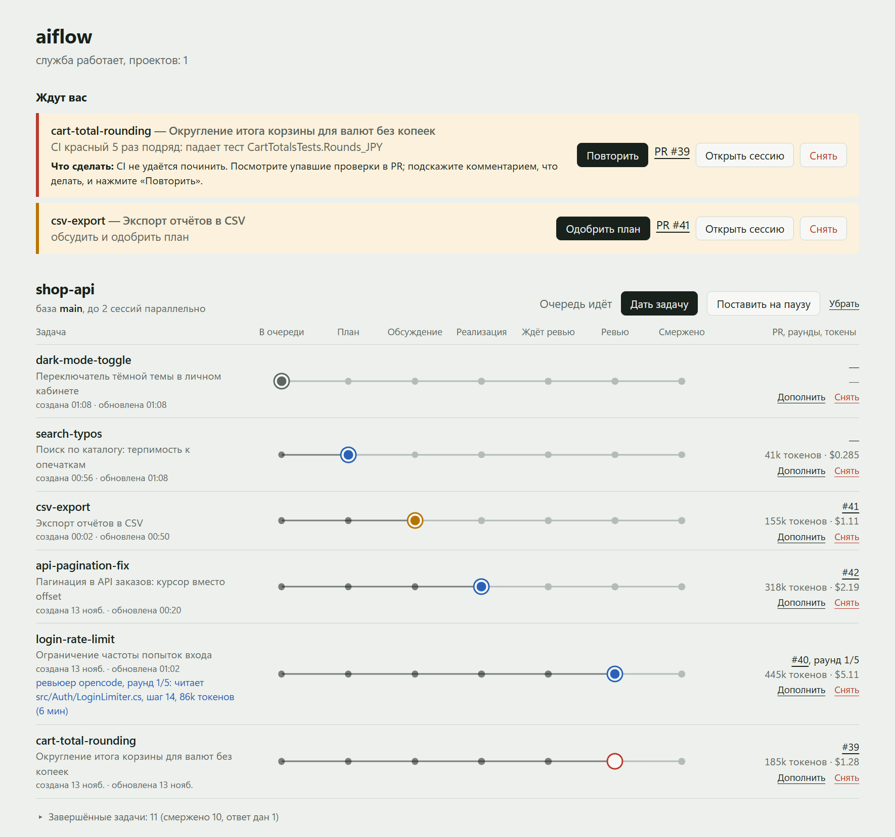
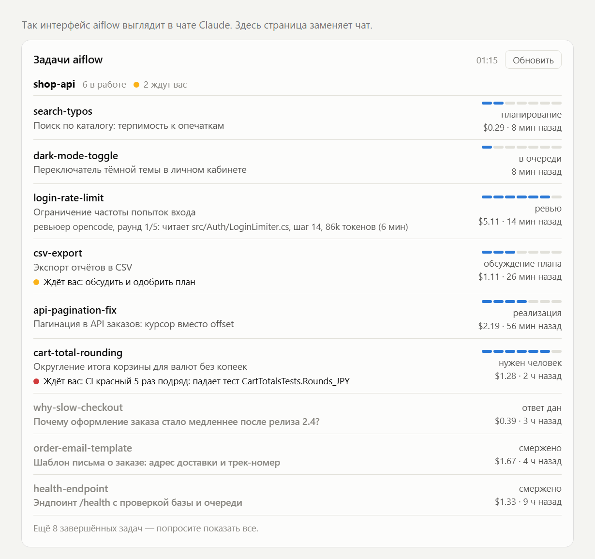
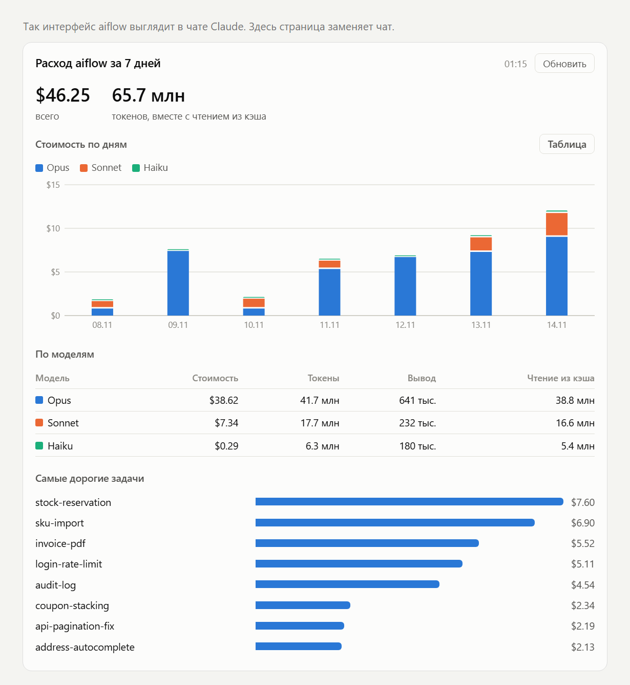

# aiflow

Плагин Claude Code: вы пишете задачи одним сообщением, дальше они сами идут по конвейеру
в фоновых сессиях.

```
задача → план (черновой PR) → ваше одобрение → реализация → AI-ревью → мерж в основную ветку
```

Очередь, порядок ревью, перезапуски и мерж ведёт программа `aiflow`, а не модель. От вас нужны
два действия: одобрить план и ответить, если задача упёрлась.



<sub>Все скриншоты — на выдуманном проекте `shop-api`.</sub>

## Как это работает

1. **Вы даёте задачу** координатору: `/aiflow:intake почини пагинацию и добавь экспорт в CSV`.
   Мелочи из одного сообщения идут одной задачей и одним PR.
2. **Планировщик** (Opus) читает код и решает: простую задачу делает сам или поручает
   исполнителю, для сложной пишет короткий план в черновом PR.
3. **Вы одобряете план** — кнопкой в панели, в уведомлении или меткой `plan-approved` в PR.
   Обсудить план можно комментарием в PR или прямо в чате планировщика.
4. **Исполнитель** пишет код и тесты. Модель выбирается по сложности: Haiku, Sonnet или Opus.
5. **Ревьюер** (DeepSeek через opencode) проверяет PR по плану. Замечания исполнитель правит
   сам, до пяти раундов.
6. **Мерж** — автоматически, после одобрения ревьюера и зелёного CI.

Если что-то требует вас, придёт системное уведомление с кнопками «Одобрить план»,
«Открыть чат», «Открыть PR», а задача появится в панели в блоке «Ждут вас».

## В чате Claude

В приложении Claude доску задач и расход токенов можно попросить прямо в чате:
«покажи задачи aiflow», «расход токенов за неделю».

| Задачи | Расход |
| --- | --- |
|  |  |

Подключение: Settings → Developer → Edit Config, в `mcpServers` добавить запись, которую
печатает команда ниже, и сразу перезапустить приложение.

```bash
python <папка плагина>/scripts/aiflow_mcp.py --config
```

## Установка

Нужны: Claude Code, Python 3.9+, `git`, `gh` (авторизован), `opencode` с моделью для ревью.

```bash
claude plugin marketplace add /путь/к/claude-plugins
claude plugin install aiflow@aiflow-local
```

Затем один раз в репозитории проекта:

```bash
aiflow init      # настройки, шаблон CI, права для фоновых сессий
aiflow doctor    # проверка среды
aiflow up        # запустить службу и панель: http://127.0.0.1:8765/
```

## На каждый день

| Что | Как |
| --- | --- |
| Дать задачу | `/aiflow:intake <текст>` в чате координатора |
| Чат с координатором | `aiflow chat` или кнопка «Дать задачу» в панели |
| Открыть панель | `aiflow ui --open` или `/aiflow:ui` |
| Состояние очереди | `aiflow status` |
| Одобрить план | кнопка в панели или `aiflow approve <id>` |
| Дополнить задачу на ходу | кнопка «Дополнить» или `aiflow amend <id> <текст>` |
| Повторить после сбоя | кнопка «Повторить» или `aiflow retry <id>` |
| Пауза и продолжение | `aiflow pause` / `aiflow resume` |
| После перезагрузки | `/aiflow:resume` или `aiflow up` |

## Подробнее

- [README плагина](plugins/aiflow/README.md) — подготовка репозитория, все команды и настройки.
- [Схема работы](docs/aiflow-workflow.md) — стадии, роли и правила очереди.
