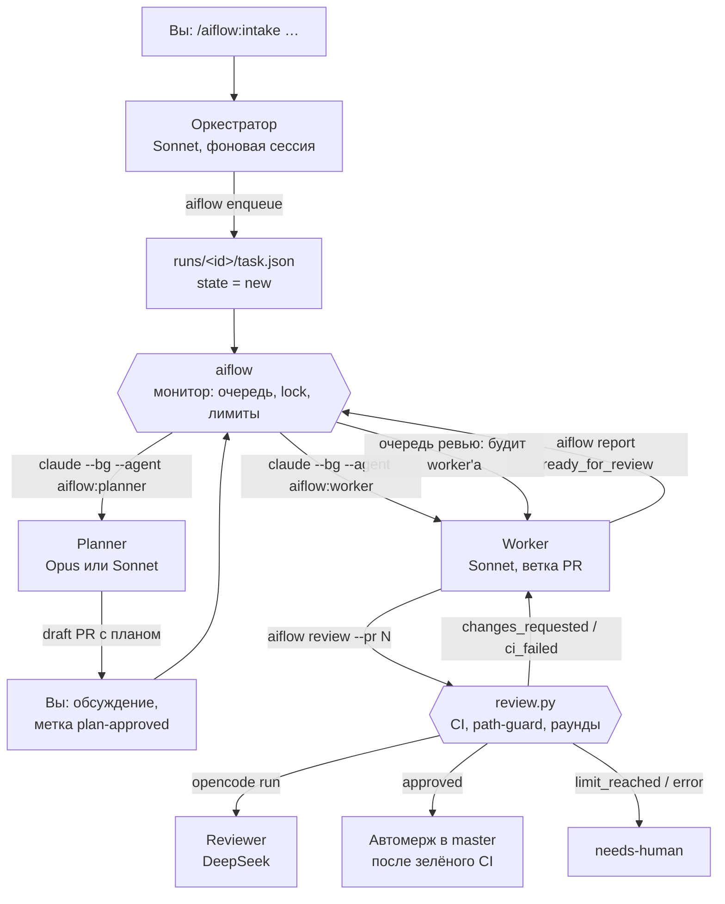
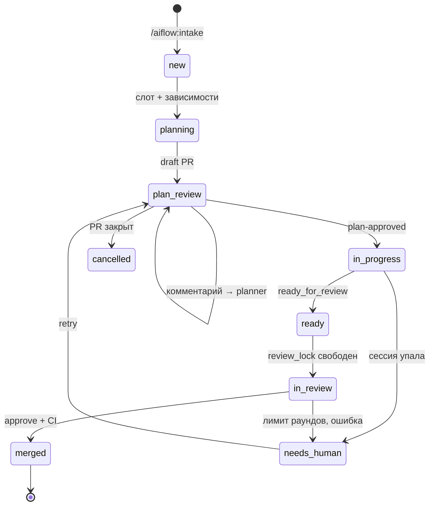

# AI-воркфлоу aiflow: задачи → план → реализация → ревью → мерж в master

Итоговое описание схемы. Задачи ведёт плагин Claude Code `aiflow`: вы пишете задачи одним сообщением, обсуждаете и одобряете планы, остальное идёт само в фоновых сессиях Claude Code. Ревью делает DeepSeek через opencode, мерж — автоматически в `master` после одобрения и зелёного CI.

## 1. Принципы

- **Состояние — в файлах и PR, не в контексте модели.** `runs/<id>/task.json` и описание PR переживают любой перезапуск. Ни одна сессия не обязана «помнить» процесс.
- **Переходы делает программа по явным сигналам.** Метка в PR, отчёт сессии, состояние сессии из `claude agents --json`, статус CI. Модель не решает, «что пора».
- **Модели работают внутри стадий.** Разбор задач, план, реализация, ревью. Каждая стадия — отдельная фоновая сессия, к которой можно подключиться и написать.
- **План — контракт.** Он лежит в описании PR, его видят ревьюер и история. Worker стартует только после вашего одобрения.
- **Fail-closed.** Всё, что не удалось проверить (неизвестная серьёзность замечания, обрезанный дифф, защищённые пути, красный CI), блокирует, а не пропускает.
- **Лимиты считает код.** Раунды ревью — по AI-ревью в PR (маркер `<!-- ai-review -->`), параллелизм и очередь ревью — в `aiflow`, rate limit — пауза очереди.
- **Ревью по одному PR.** Следующий PR встаёт на ревью только после мержа предыдущего и с rebase на свежий `master`, поэтому «одобрили, потом конфликт, снова ревью» не возникает.

## 2. Общая схема



## 3. Роли и модели

| Роль | Где задаётся | Как запускается | Модель | Делает | Не делает |
| --- | --- | --- | --- | --- | --- |
| Оркестратор | `agents/orchestrator.md` | закреплённая фоновая сессия | Sonnet | Принимает задачи через `/aiflow:intake`, отвечает о состоянии, реагирует на события монитора | Не держит состояние, не читает код, не запускает агентов в обход `aiflow`, не одобряет планы |
| aiflow | `bin/aiflow` + монитор плагина | стартует при первом `/aiflow:intake` | — | Очередь, `depends_on`, concurrency, lock ревью, пауза по лимиту, запуск и пробуждение сессий, учёт токенов, панель | Не принимает содержательных решений |
| Planner | `agents/planner.md` | `claude --bg --agent aiflow:planner` | Opus (complex) / Sonnet (simple) | Вопросы к коду и документации, draft PR с планом, макет UI, доработка плана | Не меняет код продукта, не ставит метки |
| Worker | `agents/worker.md` | `claude --bg --agent aiflow:worker` | Sonnet 5.5, effort medium / high по сложности (Opus по флагу задачи) | Реализация по плану, тесты, PR ready, цикл ревью в свою очередь | Не мержит, не одобряет, не трогает защищённые пути |
| Explorer | `agents/explorer.md` | сабагент | Haiku | Ответы на конкретные вопросы к коду | — |
| Researcher | `agents/researcher.md` | сабагент planner'а | Haiku | Выжимки из документации внешних библиотек и API | Не пишет файлы |
| review.py | `scripts/review.py` | `aiflow review --pr N` из worker'а | — | Один раунд: CI-гейт, path-guard, счётчик, ревьюер, inline-ревью, автомерж | Не принимает аргументов, меняющих лимиты |
| Reviewer | `.opencode/agent/reviewer.md` | `opencode run` | DeepSeek | Ревью диффа по плану, JSON | Не сверяет UI с макетом, только чтение |
| Вы | — | сессия оркестратора, agent view, PR, панель | — | Задачи, обсуждение и одобрение планов, разбор `needs-human`, проверка `master` | — |

**Выбор моделей.** Sonnet 5.5 — исполнитель по умолчанию: подробный план снимает архитектурные решения, остаётся исполнение, где разница с Opus небольшая, а Sonnet вдвое дешевле. Effort worker'а зависит от сложности: `medium` для `simple`, `high` для `complex` (`worker_effort` в `runs/config.json` — словарь по сложности или одна строка на все задачи). Основное «думание» уже сделано в плане, а промахи ловят CI и ревью; `max` не нужен — на нём Sonnet генерирует столько, что может выйти дороже Opus. `worker_model: opus` ставится вручную для задач, где план неполный по природе: размытые требования, исследовательский рефакторинг, новый визуальный язык. Правило пересматривается по `rounds` и `usage` в `task.json`: если `complex` на Sonnet регулярно уходит в 3+ раунда или `needs_human` из-за кода, этот класс переводится на Opus.

## 4. Жизненный цикл задачи



| Из | В | Сигнал | Действие aiflow |
| --- | --- | --- | --- |
| `new` | `planning` | свободный слот, все `depends_on` в `merged`, очередь не на паузе | запустить planner, записать id сессии |
| `planning` | `plan_review` | отчёт planner'а `plan_ready` с номером PR | записать PR; для `simple` с `auto_approve_plan` прогнать чек-лист и поставить метку |
| `plan_review` | `plan_review` | новый комментарий человека в PR | разбудить planner'а с текстом комментариев |
| `plan_review` | `in_progress` | метка `plan-approved`, свободный слот | запустить worker'а на ветке PR |
| `in_progress` | `ready` | отчёт worker'а `ready_for_review` | поставить в очередь ревью (FIFO), освободить слот |
| `ready` | `in_review` | `review_lock` свободен, PR самый старый в очереди | взять lock, разбудить worker'а: rebase на `master`, тесты, push, `aiflow review` |
| `in_review` | `merged` | PR смержен | снять lock, удалить сессии задачи, разблокировать зависимые |
| `in_review` | `needs_human` | `limit_reached`, `error`, сессия упала, метка `needs-human` | снять lock (очередь идёт дальше), объяснить причину |
| `needs_human` | `plan_review` / `new` | метка `retry`, кнопка в панели или `aiflow retry` | новый worker с контекстом PR (или новый planner, если PR нет) |
| очередь | пауза | rate limit, красный `master` после мержа, `aiflow pause` | не запускать новые сессии и не брать lock |

`concurrency` (по умолчанию 2) ограничивает сессии планирования и реализации. Ревью идёт поверх лимита, но строго по одному PR. Ждущая очереди сессия в `ready` слот не занимает. Пока PR ждёт, CI по нему уже бежит.

## 5. Intake

`/aiflow:intake <задачи>` в сессии оркестратора — единственное место, где модель решает о составе работы. Skill вызывается только человеком.

1. `aiflow doctor --quick`; при ошибках — остановка.
2. При неясности — 1–3 уточняющих вопроса одним сообщением.
3. Разбиение на задачи с id (латиница, цифры, дефисы) и `depends_on`.
4. Сложность численно: `complex`, если больше 3 файлов, новый модуль, изменение схемы данных или публичного API, неясные требования или новый визуальный язык. Иначе `simple`; для `simple` — `auto_approve_plan: true`, если вы не просили смотреть планы.
5. Для UI-задач — поле `ui`: ссылка на артборд Claude Design или «нет макета».
6. `aiflow enqueue` с JSON задач. Первый вызов skill'а поднимает монитор.

Поля, которые задаёт только человек: `allowed_protected_paths` (разрешение трогать защищённые пути) и `worker_model: opus`.

## 6. Планировщик

**Ориентирование.** Прочитать `docs/ARCHITECTURE.md`, сформулировать 3–5 конкретных вопросов к коду и 1–2 к документации, раздать их параллельно explorer и researcher (Haiku), дочитать решающие файлы самому. Отдельной стадии «предварительного поиска» нет: вопросы ставит сильная модель, исполняет слабая.

**Draft PR.** Ветка `ai/<id>` от `master`, пустой коммит, `gh pr create --draft`, затем `git switch --detach`, чтобы освободить ветку для worker'а. Отчёт: `aiflow report <id> --role planner --status plan_ready --pr N`.

**Шаблон плана в описании PR:**

```markdown
<!-- ai-plan v1 -->
## Цель и границы
Что входит. Что точно не входит.
## Критерии приёмки
- [ ] проверяемые пункты
## Файлы
| Файл | Изменение |
## Интерфейсы и данные
## Граничные случаи
## Тесты
Какие добавить; команды проверки.
## UI
Ссылка на артборд, что реализуем, обязательные состояния.
## Риски и пересечения
## Рассмотренные варианты
Что отвергнуто и почему.
## История изменений плана
## Оценка реализации: simple | complex
```

**Как обсуждать план** — результат всегда оказывается в описании PR:

| Способ | Когда удобно |
| --- | --- |
| `claude agents` → строка `planner: <id>` → пробел (короткий ответ) или Enter (полный чат) | Тот же день, нужен контекст прочитанного кода |
| `claude attach <id>` (id — в `aiflow status` или кнопка «Открыть сессию» в панели) | То же, напрямую |
| Комментарий в draft PR — aiflow сам разбудит planner'а | Асинхронно, история в PR |
| `/aiflow:discuss <PR>` — свежая сессия по описанию и комментариям | Простые планы или давно простаивающий planner, дешевле resume |

После обсуждения в чате попросите planner'а обновить PR и отчитаться: пока отчёта нет, aiflow считает, что план обсуждается.

**Одобрение плана** делаете только вы: метка `plan-approved`, кнопка в панели или `! aiflow approve <id>`. Агентам эта команда запрещена правами. Для `simple` с `auto_approve_plan` метку ставит aiflow, если план проходит чек-лист: маркер `<!-- ai-plan -->`, чекбоксы в критериях приёмки, непустые разделы «Тесты», «Файлы», «Цель и границы», и ни один файл плана не попадает в защищённые пути.

## 7. Worker и ревью

**Ход 1 — реализация.** Переключиться на `ai/<id>` в своём worktree; прочитать план; реализовать, меняя только файлы из плана; прогнать сборку, линтер, типы и тесты (выводить только упавшее); дописать в PR разделы «Решения» и «Проверки»; push, `gh pr ready`; отчёт `ready_for_review`; закончить ход.

**Ход 2 — ревью**, когда aiflow будит worker'а: `git fetch`, `git rebase origin/master`, тесты, `git push --force-with-lease`, затем цикл `aiflow review --pr N`.

**Что делает один вызов `aiflow review`:**

| Шаг | Проверка | Если не прошло |
| --- | --- | --- |
| 1 | PR открыт | `already_closed` |
| 2 | Число AI-ревью с маркером `<!-- ai-review -->` меньше `max_rounds` | метка `needs-human`, `limit_reached` |
| 3 | Нет комментариев человека с `<!-- human -->` без ответа | `human_input`, раунд не расходуется |
| 4 | CI: ждёт завершения проверок | `ci_failed` с именами job и хвостом логов, раунд не расходуется |
| 5 | Изменённые файлы не попадают в защищённые пути (кроме `allowed_protected_paths`) | blocking-ревью без вызова модели |
| 6 | Контекст: описание PR, история раундов с тредами, дифф | — |
| 7 | `opencode run --agent reviewer`, две попытки разобрать JSON | `error` |
| 8 | Нормализация: неизвестная серьёзность → blocking; обрезанный дифф без `diff_fully_read: true` → blocking | — |
| 9 | Ревью в PR: inline-комментарии на строки из диффа, остальное в общем тексте. `review_identity: self` — от вашего аккаунта событием `COMMENT` (GitHub не даёт одобрить свой PR), `bot` — от бота с `APPROVE`/`REQUEST_CHANGES` | — |
| 10 | При вердикте approve: `gh pr merge --auto --squash`, без защиты ветки — сразу `gh pr merge --squash` | `merge_conflict` |

**Статусы для worker'а:**

| Статус | Действие |
| --- | --- |
| `ci_failed` | Починить, тесты, push, снова ревью |
| `changes_requested` | Исправить все blocking; ответить на каждое замечание: в треде — `aiflow reply`, остальное — комментарием с `<!-- ai-review-reply -->` («исправлено: как» или «не согласен: почему»); снова ревью |
| `merge_conflict` | Rebase на `master`, тесты, push, снова ревью |
| `human_input` | Учесть комментарий человека, ответить, снова ревью |
| `approved` | Готово |
| `limit_reached`, `already_closed`, `error` | Остановиться, кратко описать открытые замечания и причину |

**Правила ревьюера:** blocking — только ошибки, расхождения с планом и критериями приёмки, безопасность, потеря данных, сломанные контракты, отсутствие поведенческих тестов на новую логику; minor мерж не блокирует; решения из «Решений» не оспариваются, если не противоречат плану и не вводят ошибку; отклонённое с аргументами замечание не поднимается повторно без новых доводов; тесты должны проверять поведение, а не реализацию; изменения защищённых путей вне плана — всегда blocking; соответствие UI макету не проверяется.

## 8. Мерж в master

Отдельной ветки `integration` нет: одобренный PR с зелёным CI сразу уходит squash-мержем в `master`. Что держит `master` в порядке:

- **Ворота мержа — `review.py`:** он ждёт зелёного CI и мержит только при вердикте approve. Этого достаточно и без защиты ветки (в приватных репозиториях на бесплатном плане GitHub она недоступна).
- **Защита ветки (если доступна):** обязательный PR и обязательные проверки CI, «Require branches to be up to date». Обязательное одобрение включайте только с `review_identity: bot` — свой PR вы одобрить не можете; CODEOWNERS и «Require approval of the most recent push» не включаются.
- **Очередь ревью:** в ревью и мерже один PR за раз, с rebase на свежий `master` перед ревью.
- **CI после мержа** (`on: push: branches: [master]`): если `master` покраснел, aiflow ставит очередь на паузу, пока он снова не позеленеет.
- **Squash-мерж:** каждая задача — один коммит, откатить её — один `git revert`.

Компромисс: изменения попадают в `master` до вашей ручной проверки. Ваша приёмка происходит после мержа, а найденные проблемы становятся новыми задачами или откатом. Если для какого-то проекта нужен ручной мерж, в текущей версии aiflow это делается выключением автомержа в настройках репозитория: PR останется одобренным, и вы смержите его сами (задача останется в `in_review`, пока PR не смержен).

## 9. UI и дизайн

- **Дизайн-система — в репозитории:** токены, базовые компоненты, короткий `design/DESIGN.md`, синхронизация с Claude Design через `/design-sync`. `design/` и `components/ui/` — защищённые пути.
- **Экраны не коммитятся одним большим HTML.** Раздел «UI» плана ссылается на конкретный артборд Claude Design; worker читает только его.
- **Новая страница без дизайна:** planner делает макет через `/design`, вы правите его на холсте или комментарием. Если инструментов Design в фоновой сессии нет, макет делаете вы до intake. Worker не угадывает стиль по соседним страницам.
- **Ревьюер UI не сравнивает с макетом:** только дисциплину в диффе — компоненты из `components/ui/`, отсутствие хардкода цветов и inline-стилей, наличие требуемых состояний.
- **Визуальная приёмка — ваша.** Расхождения — одной задачей `simple` «UI-правки по экранам X, Y».
- **Модели:** Opus там, где дизайн рождается; Sonnet там, где применяется.

## 10. aiflow: монитор, сессии, панель

**Supervisor** — служба Claude Code, которая хостит фоновые сессии. Каждая сессия — отдельный процесс; простаивающую без подключения около часа он останавливает (диалог остаётся на диске), упавшую перезапускает; сон машины сессии переживают, выключение — нет.

**Монитор.** `aiflow run --events` работает монитором плагина в закреплённой сессии оркестратора. Раз в 30–60 секунд — проход: прочитать `claude agents --json` и метки PR, применить переходы, запустить сессии, обновить usage. В вывод (и тем самым оркестратору) попадают только события, требующие реакции: план готов, нужен человек, сессия ждёт ответа, пауза, пачка завершена. Перед запуском сессии в `task.json` пишется `state: launching`, чтобы сбой между запуском и записью id не породил дубль. Второй экземпляр монитора выходит по lock-файлу.

**Команды:**

| Команда | Назначение |
| --- | --- |
| `aiflow init` / `doctor` | Подготовить репозиторий / проверить среду |
| `aiflow status [--json]` | Состояние очереди |
| `aiflow approve <id>` | Одобрить план |
| `aiflow retry <id>` | Повторить задачу в `needs_human` |
| `aiflow pause [причина]` / `resume` | Пауза очереди: новые сессии не стартуют, работающие доделывают ход |
| `aiflow stop` | Остановить монитор и панель; продолжить — `/aiflow:resume` |
| `aiflow ui [--open] [--detach] [--stop]` | Панель |
| `aiflow tick` | Один проход вручную |
| `aiflow enqueue`, `report`, `review`, `reply` | Команды для агентов |

**Панель** поднимается вместе с монитором на `http://127.0.0.1:8765/`: вверху то, что ждёт вас (кнопки «Одобрить план», «Повторить», «Открыть сессию»), ниже доска задач по стадиям и лента событий, в разделе «Настройки» — выбор модели ревьюера opencode (пишется в `reviewer_model` в `runs/config.json`). Слушает только loopback, действия защищены токеном страницы. В Claude Desktop её можно открыть в Browser pane вкладки Code через конфигурацию `aiflow` в `.claude/launch.json` (её добавляет `aiflow init`) и вынести в отдельное окно. Добавить пункт в боковое меню Desktop плагин не может. Для строки состояния есть `aiflow statusline`.

**Как остановить:** пауза очереди — кнопка или `aiflow pause`; монитор и панель — `aiflow stop`; сами фоновые сессии — `Ctrl+X` в `claude agents` или `claude stop <id>`.

## 11. Плагин и подготовка репозитория

**Состав плагина:** агенты `orchestrator`, `planner`, `worker`, `explorer`, `researcher`; skills `intake`, `resume`, `discuss`, `ui`; монитор; хук проверки среды; `bin/aiflow`; `scripts/aiflow.py`, `review.py`, `aiflow_ui.py`, `ui.html`; шаблоны для репозитория.

**Установка:**

```bash
claude plugin marketplace add /путь/к/aiflow-marketplace
claude plugin install aiflow@aiflow-local
```

**Подготовка репозитория:**

1. `gh auth login` вашим аккаунтом: по умолчанию (`review_identity: self`) ревью и мерж идут от него. Отдельный бот нужен, только если хотите, чтобы GitHub требовал одобрение: тогда `review_identity: bot`, бот-аккаунт с правами Write и его token (Contents, Pull requests, Issues — read/write) в `~/.config/ai-review/token` или `REVIEW_BOT_TOKEN`.
2. Settings → General: Allow squash merging (и Allow auto-merge, если есть защита ветки). Защита `master` — по желанию, как в разделе 8.
3. `! aiflow init` в сессии Claude Code в корне репозитория: `runs/config.json`, шаблоны ревьюера, `ci.yml`, `ARCHITECTURE.md`, права для фоновых сессий, конфигурация панели для Desktop, метки.
4. В `runs/config.json`: `"base_branch": "master"` (значение по умолчанию), `reviewer_model` из `opencode models deepseek` (или выбрать в панели, раздел «Настройки»).
5. Заполнить `ci.yml` реальной сборкой и тестами, в том числе на `push` в `master`; сделать job обязательной проверкой.
6. Добавить в `.claude/settings.json` allow-правила для сборки и тестов проекта, иначе фоновые сессии будут ждать разрешения.
7. Один раз открыть `claude` в репозитории интерактивно и принять доверие к папке.
8. `! aiflow doctor`.

**Основные настройки `runs/config.json`:** `concurrency` (2), `tick_seconds` (45), `base_branch`, `ui_port` (8765, `0` — без панели), `permission_mode` (`acceptEdits`), `planner_model` и `planner_effort` по сложности, `worker_model` и `worker_effort` (строкой или по сложности), `reviewer_model`, `max_rounds` (5), `max_diff_chars`, `ci_timeout_minutes`, `rate_limit_pause_minutes`, `watch_integration` (следить за CI базовой ветки после мержа), `protected_paths`.

## 12. Ваша работа день за днём

1. Открыть и закрепить сессию оркестратора: `claude --bg --agent aiflow:orchestrator --name aiflow "Готов к задачам"`, затем в `claude agents` выделить строку, `Ctrl+T`, Enter.
2. `/aiflow:intake 1) … 2) …`
3. По событию «план готов» — обсудить план и одобрить.
4. По ходу работы — вопросы оркестратору («что с пачкой?»), идеи worker'у — ответом в его сессии или комментарием `<!-- human -->` в PR.
5. По событию «нужен человек» — оркестратор объяснит причину; поправить план и повторить, либо решить разногласие с ревьюером самому.
6. Проверить `master` после мержей; найденное — новой пачкой через `/aiflow:intake`.
7. После перезагрузки машины — `/aiflow:resume` в сессии оркестратора.

## 13. Обкатка на тестовом репозитории

Приватный репозиторий с маленьким проектом и настоящими тестами в CI. Для экономии: `concurrency: 1`, `max_rounds: 2`, Sonnet для планирования.

1. **Монитор:** `/aiflow:resume` в закреплённой фоновой сессии — строка `[aiflow] монитор запущен` и живая панель. Главная непроверенная часть.
2. **Простая задача с автоодобрением** — весь путь до мержа без вас, без зависаний на разрешениях.
3. **Сложная задача с обсуждением** — разговор с planner'ом, комментарий в PR, пробуждение, обновление плана, одобрение.
4. **Очередь ревью** — две задачи на один файл при `concurrency: 2`: второй PR ждёт мержа первого и проходит без конфликта.
5. **Зависимость** — B не стартует до мержа A.
6. **Защищённые пути** — задача с правкой `ci.yml` блокируется без вызова DeepSeek.
7. **Красный CI** — `ci_failed` без расхода раунда.
8. **needs_human и повтор** — остановить worker'а, повторить из панели.
9. **Остановка и восстановление** — `aiflow stop`, `/aiflow:resume`.

Где искать причины: `runs/events.jsonl` → `runs/<id>/log.jsonl` → `report.json` и `review.json` → `claude logs <id>`.

## 14. Подписка и правила использования

aiflow не читает и не передаёт токены подписки и не обращается к API напрямую: он запускает официальный бинарник `claude`, в который вы вошли сами. Правила Claude Code прямо допускают вход пользователя в немодифицированный Claude Code со своей подпиской, а `claude agents --json` описан как поддерживаемый способ следить за фоновыми сессиями из скрипта. Запрещено другое: использовать OAuth-токены подписки в сторонних инструментах и пропускать через свою подписку чужие задачи. Серая зона — объём: лимиты Pro и Max рассчитаны на обычное индивидуальное использование, поэтому параллелизм держится на 1–2. Это прочтение опубликованных правил, а не юридическая консультация; за подтверждением для своего сценария можно обратиться в поддержку Anthropic.

## 15. Оговорки

| Оговорка | Что это значит |
| --- | --- |
| Agent view в research preview | Флаги CLI могут меняться; все вызовы `claude` собраны в классе `Claude` в `scripts/aiflow.py` |
| Мониторы плагинов работают только в интерактивных сессиях | Фоновая сессия интерактивна, но это первое, что нужно проверить |
| Фоновые сессии локальные | Выключение машины их останавливает: `/aiflow:resume`, затем `aiflow retry` |
| Монитор живёт, пока жива сессия оркестратора | Сессия закреплена; всё состояние в `runs/`, новый монитор продолжает с того же места |
| Каждое событие монитора стоит токенов оркестратору | Печатается только то, что требует реакции |
| Значения `userConfig` плагина не доходят до команд агентов | Настройки — в `runs/config.json`, токен бота (режим `bot`) — в файле или переменной окружения |
| Deny-правила обходятся при желании | В режиме `self` агенты работают с вашим `gh`, и смержить в обход ревью им мешают только deny-правила (`gh pr merge`, `gh api`) и инструкции. Жёсткая граница — режим `bot` с обязательным одобрением в защите ветки |
| GitHub принимает inline-комментарии только на строки диффа | `review.py` проверяет строки по hunks, остальное идёт в общий текст ревью |
| Мерж без промежуточной ветки | Приёмка после мержа; защита — CI, очередь ревью, пауза при красном `master`, squash для отката |
